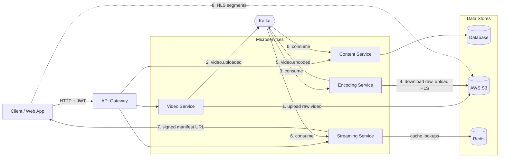

# 🎬 Netflix Streaming Core

A microservices-based video streaming platform built with **Spring Boot**, **Kafka**, **Redis**, **AWS S3**, and **FFmpeg**.

> Video uploaded → stored in S3 → encoded to multiple qualities → packaged as HLS → streamed securely with adaptive bitrate.


---

## 📑 Table of Contents

- [Features](#-features)
- [Tech Stack](#-tech-stack)
- [Architecture](#-architecture)
- [Services](#-services)
- [Video Processing Flow](#-video-processing-flow)
- [HLS Output Structure](#-hls-output-structure)
- [Getting Started](#-getting-started)
- [Configuration](#-configuration)
- [API Overview](#-api-overview)
- [Project Structure](#-project-structure)
- [Contributing](#-contributing)
- [License](#-license)

---

## ✨ Features

- 📤 **Video upload** of large raw files straight to AWS S3
- 🎞️ **Multi-resolution encoding** (240p to 1080p) using FFmpeg
- 📺 **HTTP Live Streaming (HLS)** with adaptive bitrate playback and no buffering
- ⚡ **Event-driven pipeline**: upload and encoding are decoupled through Kafka
- 🚀 **Redis caching** for fast playback start-up
- 🔐 **Secure delivery** with a private S3 bucket and time-limited access URLs
- 🗂️ **Content metadata management**: titles, descriptions, status, thumbnails
- 📈 **Independently scalable** services

---

## 🧰 Tech Stack

| Layer | Technology |
|---|---|
| Language / Framework | Java, Spring Boot |
| Messaging | Apache Kafka, Zookeeper |
| Caching | Redis |
| Object Storage | AWS S3 |
| Access Control | AWS IAM, signed URLs |
| Video Processing | FFmpeg |
| Streaming Protocol | HTTP Live Streaming (HLS) |
| Database | Relational DB for content metadata |
| Containerization | Docker, Docker Compose |
| Build Tool | Maven / Gradle |

---

## 🏗 Architecture

The platform follows a microservices architecture. Videos are uploaded through the **Video Service**, processed asynchronously by the **Encoding Service** via **Kafka**, and served to viewers by the **Streaming Service**. Raw files and HLS output both live in **AWS S3**, and the player fetches segments directly from S3 using secure URLs.



**Reading the diagram:** solid arrows are service calls and events, the dotted arrow is the player fetching video segments directly from S3. Numbers show the order of the upload-to-playback flow.

---

## 🧩 Services

| Service | Responsibility |
|---|---|
| **content-service** | Content metadata: titles, descriptions, genres, thumbnails, status |
| **video-service** | Handles raw video upload to S3 and publishes the upload event |
| **encoding-service** | Consumes upload events, runs FFmpeg, produces HLS renditions, uploads to S3 |
| **streaming-service** | Resolves manifests, generates secure S3 URLs, caches lookups in Redis |
| **data-service** | Kafka, Zookeeper, Redis, and database infrastructure setup |

---

## 🔄 Video Processing Flow

1. A **content record** is created through the content service.
2. The user uploads a **raw video** through the video service.
3. The video service **stores the file in S3** and publishes a `video.uploaded` event to **Kafka**.
4. The **encoding service** consumes the event and downloads the raw file.
5. **FFmpeg** transcodes it into multiple resolutions and splits it into HLS segments.
6. The HLS output is **uploaded back to S3**, and a `video.encoded` event is published.
7. The **streaming service** and content service consume the event and mark the video as **playable**.
8. The viewer requests playback and receives a **secure HLS manifest URL**.
9. The player **adaptively fetches segments** based on network speed.

---

## 📺 HLS Output Structure

```
<video-id>/
├── master.m3u8          # lists all available renditions
├── 240p/
│   ├── index.m3u8
│   └── segment_000.ts
├── 480p/
│   ├── index.m3u8
│   └── segment_000.ts
├── 720p/
│   ├── index.m3u8
│   └── segment_000.ts
└── 1080p/
    ├── index.m3u8
    └── segment_000.ts
```

---

## 🚀 Getting Started

### Prerequisites

- Java 17+
- Maven or Gradle
- Docker and Docker Compose (for Kafka, Zookeeper, Redis, and the database)
- [FFmpeg](https://ffmpeg.org/download.html) installed and available on your `PATH`
- An AWS account with an **S3 bucket** and an **IAM user** (access key and secret key)

### 1. Clone the repository

```bash
git clone https://github.com/<your-username>/netflix-streaming-core.git
cd netflix-streaming-core
```

### 2. Start infrastructure

```bash
docker-compose up -d
```

This starts Kafka, Zookeeper, Redis, and the database.

### 3. Set up AWS

1. Create a **private** S3 bucket (keep *Block all public access* enabled).
2. Create an IAM user with a least-privilege policy for that bucket (`s3:PutObject`, `s3:GetObject`, `s3:DeleteObject`, `s3:ListBucket`).
3. Generate an access key and secret key.

### 4. Set environment variables

```bash
export AWS_ACCESS_KEY_ID=your_access_key
export AWS_SECRET_ACCESS_KEY=your_secret_key
export AWS_REGION=your_region
export S3_BUCKET_NAME=your_bucket_name
```

### 5. Run the services

Start each service from its own directory:

```bash
cd content-service && ./mvnw spring-boot:run
cd video-service && ./mvnw spring-boot:run
cd encoding-service && ./mvnw spring-boot:run
cd streaming-service && ./mvnw spring-boot:run
```

---

## ⚙️ Configuration

Each service has its own `application.yml` / `application.properties`. Key settings:

| Property | Description |
|---|---|
| `spring.datasource.*` | Database connection |
| `spring.kafka.bootstrap-servers` | Kafka broker address |
| `spring.data.redis.host` / `port` | Redis connection |
| `aws.s3.bucket` | S3 bucket name |
| `aws.region` | AWS region |
| `aws.access-key` / `aws.secret-key` | IAM credentials (use environment variables) |
| `ffmpeg.path` | Path to the FFmpeg binary |
| `encoding.temp-dir` | Temporary working directory for encoding |
| `streaming.url-expiry-minutes` | Lifetime of secure playback URLs |

> ⚠️ Never commit secrets. Use environment variables or a secrets manager.

---

## 📡 API Overview

Protected endpoints require the header:

```
Authorization: Bearer <JWT_TOKEN>
```

> Endpoint paths below are illustrative. Adjust them to match your implementation.

| Area | Method | Endpoint | Description |
|---|---|---|---|
| Content | POST | `/api/content` | Create content metadata |
| Content | GET | `/api/content/{id}` | Get content details |
| Content | GET | `/api/content` | List content |
| Video | POST | `/api/videos/upload` | Upload a raw video |
| Video | GET | `/api/videos/{id}/status` | Check upload / encoding status |
| Streaming | GET | `/api/stream/{videoId}` | Get secure HLS master playlist URL |
| Streaming | GET | `/api/stream/{videoId}/{path}` | Serve playlist / segment |

---

## 📂 Project Structure

```
.
├── content-service/
├── video-service/
├── encoding-service/
├── streaming-service/
├── data-service/
├── docker-compose.yml
├── LICENSE
└── README.md
```

---

## 🤝 Contributing

Contributions are welcome!

1. Fork the repository
2. Create a feature branch (`git checkout -b feature/amazing-feature`)
3. Commit your changes (`git commit -m "Add amazing feature"`)
4. Push to the branch (`git push origin feature/amazing-feature`)
5. Open a Pull Request

---

## ⚠️ Disclaimer

This project is for **educational purposes only** and is inspired by Netflix's streaming architecture. It is not affiliated with or endorsed by Netflix. Only upload content you have the rights to use.

---

## 📄 License

This project is licensed under the **MIT License**. See the [LICENSE](LICENSE) file for details.